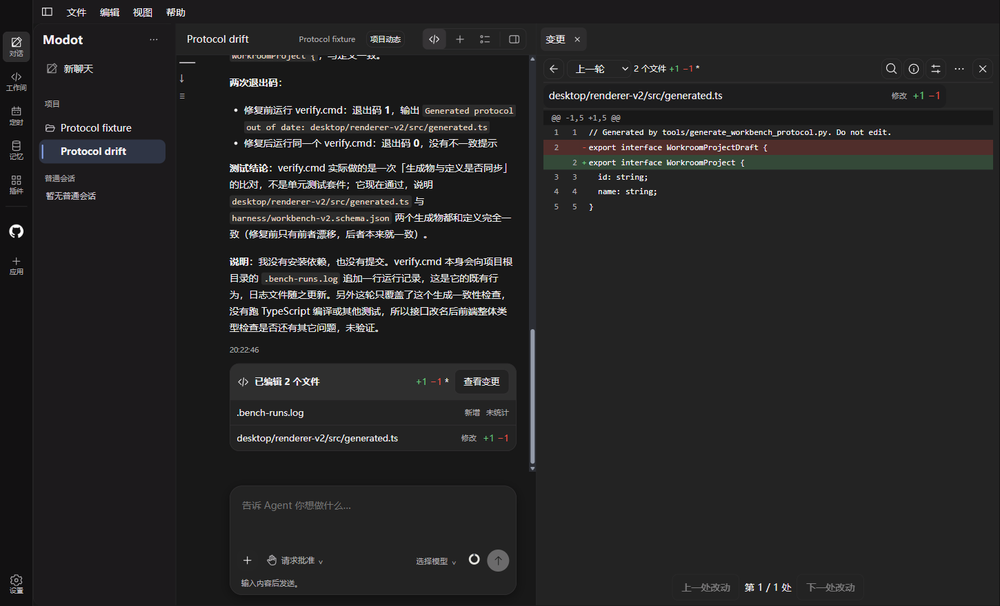

# Modot — Windows Coding Agent

[Download Windows x64 Preview .13](https://github.com/lq755467102-art/modot/releases/download/v0.2.0-preview.13/Modot-Preview-0.2.0-preview.13-x64-Setup.exe) · [SHA256](https://github.com/lq755467102-art/modot/releases/download/v0.2.0-preview.13/SHA256SUMS.txt) · [Release notes](https://github.com/lq755467102-art/modot/releases/tag/v0.2.0-preview.13) · [简体中文](README.md) · [Source-available license](LICENSE)

**Modot is a compact, customizable desktop AI agent with a built-in code workroom.** Open a local project and bring your own model to read code, edit files and run checks. Workrooms and chats share project scope, permissions and action receipts. Choose a memory provider and pick a specialist model when a task needs one.

[Quickstart](#quickstart) · [Workrooms, task cores and memory](#workrooms-task-cores-and-memory) · [Build an extension](#build-an-extension) · [Design notes and measurements](#design-notes-and-measurements) · [License](#license)

## Workrooms, task cores and memory

**Continue the same chat from a workroom.** When the agent fixes a test, open the source from review in the directory or Git worktree used by the chat. The side panel keeps that chat’s history, streaming replies and approvals. Attach the file or selection to ask a follow-up. The GitHub Workroom uses the same interaction. Open a PR and ask about a failed check, navigate to that check, or inspect the file in the local checkout. Website sign-in and GitHub App authorization have separate controls. [Workrooms and chat](docs/modules.md#工作间和会话)

**Choose a task core for specialist work.** The main agent can work independently. A child agent uses the parent’s model to handle a scoped part of the task. A task core uses a specialist model you select and works within its own chat and permissions. The parent reviews the result and owns the final delivery. The Vision Core is the first built-in preset and is available under **Settings → Models**. [Vision Core quickstart](examples/worker-vision/) · [Task cores and delegation](docs/modules.md#任务核心与委派)

**Choose what the agent remembers and how it remembers it.** Keep an investigation note in one chat, save a test convention to a project, or adopt a practice as a habit across projects. In the built-in memory tree you can edit entries, set weights, and choose full, lean or disabled memory inclusion per chat. Switch to per-chat notes or turn off the memory provider entirely. Each provider keeps its data when you switch, and retrieval checks current access to the sources. [Memory settings and providers](docs/modules.md#记忆怎么自定义) · [Chat notes example](examples/memory-notes/)

## Quickstart

1. **Start Modot on Windows.** Download the .13 installer above or launch a source checkout with CPython 3.13 and Node.js 24. [Install or run from source](docs/install.md)
2. **Connect your model.** In **Settings → Models**, enter the provider endpoint, model name and API key. Requests use the service and account you configure.
3. **Open a project and give it a task.** Create a project from an existing folder. Replace the test command below with one that reproduces a failure in your project, then send it in chat.

> Run `<test command>` to reproduce the failure. Find the first failing test, make the smallest fix, and run the same command again. Tell me which file changed, both exit codes, and the outcome of that test.

After the task, open **Changes** to inspect the diff and expand the execution history to see the command and its output. With this repository, set up the source environment first, then run `python tools/generate_workbench_protocol.py --check` to verify the generated workspace protocol files. [Protocol check](tools/generate_workbench_protocol.py)



*From the desktop benchmark. Chat shows `verify.cmd` going from exit 1 to exit 0 while the review pane shows the generated-file fix.* [Task and independent grading](docs/benchmarks/matched-desktop-memory.md)

## What you can do in a project

- **Use the Workroom for everyday editing.** Search for a file, review a diff, preview an attachment or run a check. Start in a plain folder or a Git project, and enable language plugins for TS/JS, C/C++, Rust or Python as needed. [Projects and language services](docs/modules.md#各模块如何自定义)
- **Pick up where you left off.** Retrieve earlier operations and their original results as permissions allow. Open an image, read a range of rows from a spreadsheet, or ask for frames from a time range in an MP4 or WebM attachment. Open the matching run to verify the source of an earlier result. [Conversation, attachment and retrieval APIs](docs/protocols.md)
- **Schedule a recurring check.** Each plan has one conversation. Scheduled runs, manual runs and catch-up runs appear there with individual records. [Scheduler and run history](docs/modules.md)

Projects, chat history and tool receipts are stored locally. Each model request sends the selected context to your configured provider. The local host enforces tool access and checks current permissions when retrieving history. [Data flow and permissions](docs/modules.md)

## Build an extension

Choose the project checkout, the chat’s execution settings and sources, the model provider, what goes into context, and when a plan runs. Developers can package workflows as Skills, connect MCP tools, or contribute application pages, memory providers and delegation methods. These entry points share the host’s projects, conversations, permissions and receipts. [Configuration and extension points by module](docs/modules.md#各模块如何自定义)

| What you want to add | Start from a working example |
| --- | --- |
| **Skill** · Apply your team’s workflow to a task | Adapt the example `SKILL.md` to say when it applies, which steps to take, and what to check. [Outline Skill](examples/plugin-catalog/legacy-skill/skills/outline/SKILL.md) |
| **MCP tool** · Read your own data or call an existing service | `mcp.json` declares a local service, and standard Python implements `read_note`. The tutorial takes you from input validation to a tool result in chat. [Connect your first tool](docs/develop-a-tool.md) |
| **Plugin page** · Add an entry point to the desktop | Declare a data page with content and actions. The example adds a suggestion to a chat draft. [Example page](examples/plugin-catalog/studio-v1/data-pages/overview.json) · [Page schema](docs/contracts/plugin-data-page-v1.schema.json) |
| **Memory provider** · Choose a memory implementation for chats | The notes package uses `memoryProvider` to declare the preview’s data-only `session-notes` adapter. Install the package and select it under **Memory provider**. [Memory package](examples/memory-notes/) · [API reference](docs/protocols.md) |
| **Delegation** · Add a child-agent method or a specialist task core | Declare inputs, outputs and requested capabilities in `plugin.json`. Task cores also declare a model role. The `modot.worker/1-draft` contract is a preview. [Scout example](examples/worker-scout/) · [Vision Core](examples/worker-vision/) · [Worker contract](docs/worker-plugin-contract.md) |

With the source environment configured, run these commands from the repository root to check the sample package, verify the generated protocol, and run the relevant regressions.

```powershell
& $env:HARNESS_PYTHON -B desktop/renderer-v2/tools/validate_plugin_manifest.py --json examples/plugin-catalog/studio-v1
& $env:HARNESS_PYTHON tools/generate_workbench_protocol.py --check
& $env:HARNESS_PYTHON -m unittest tools.test_worker_examples tools.test_public_preview
```

Electron uses a restricted bridge to a local HTTP service that owns projects, conversations and permissions. The protocol reference maps endpoints and example payloads to tests. The module map points to context assembly, execution policy and change review. [APIs and schemas](docs/protocols.md) · [Modules and data flow](docs/modules.md)

## Design notes and measurements

**A smaller first request can lead to more turns.** Moving 97 historical tool receipts behind on-demand retrieval cut the first input by 93.4%. One retest grew from 21 model requests to 57 and cost more overall. The request trace showed repeated receipts from the current task. We evaluate a context change against the full task’s cost, elapsed time and graded result. [Three recorded runs and how to read the requests](docs/engineering-efficiency.en.md)

**Trace a bad result to the model, the environment or the agent runtime.** Pin the source, working directory, dependencies and access settings. Run a known failure and a known fix against an independent grader. Investigate the execution environment if a command could not start. Inspect the tool receipt if it omitted the failing test. Count a false claim if the model saw that failure and still reported success. Follow each receipt into the actual model request to see what information was available. [Engineering scorecard](docs/benchmarks/modot-engineering-scorecard.md) · [Diagnostic workflow](docs/engineering-efficiency.en.md)

**Record image reads and model delivery separately.** When two operations read the same pixels, associate delivery with the originating action in the request that actually carried them. Recheck permissions before returning an attachment if access changed during the read. The source and targeted tests cover both cases. [Release review](docs/release-review.md) · [Regression tests](tools/test_public_preview.py)

### Install size and desktop memory

The first Windows x64 preview installer measured about **136 MiB**, with about **597 MiB** installed. Those figures describe the first preview's dependencies and installation process. Later previews bundle the verified LGPL video runtime, and setup still checks the pinned MinGit digest. The memory comparison below also refers to the versions listed in its report. [First preview validation](docs/benchmarks/preview-validation.json) · [Current installation process](docs/install.md)

On one Windows 11 machine, three desktop clients fixed the same generated file in identical copies of a 626-file project. An independent check confirmed the same single-file fix and command exits of **1 → 0** for all three.

| Desktop client | Fresh launch | Project open | Running the task |
| --- | ---: | ---: | ---: |
| Modot | 143.1 / 146.2 | 166.9 / 170.3 | **249.1 / 275.2** |
| Codex | 558.2 / 1,628.4 | 1,105.4 / 1,110.0 | 1,340.0 / 1,481.2 |
| WorkBuddy | 1,184.6 / 1,189.5 | 822.3 / 825.8 | 1,405.8 / 1,518.3 |

Figures are **median / sampled peak** private working set for the whole app process tree, in MiB. Each client ran once, with different models, loaded account content and approval settings. The report gives the exact measurement windows and all 320 samples. [Full desktop memory experiment](docs/benchmarks/matched-desktop-memory.md) · [Raw samples](docs/benchmarks/matched-desktop-memory.json)

In an earlier engineering comparison, Modot Pilot + DeepSeek Flash and Codex CLI + GPT-6.2 Sol each passed 9/10 scoring entries. Across the nine entries both completed, Modot took 21.3% less total time and used about twice the tokens. [Per-case scores and conditions](docs/benchmarks/modot-engineering-scorecard.md) · [Score data](docs/benchmarks/modot-2026-11-23-results.json)

## Contribute from source

Start in `desktop/renderer-v2` for UI changes, `loop` for agent behavior, tools and results, and `tools` for tests. When reporting a reproducible issue, include your version, model, approval mode, the command you ran and what happened. [Run, test and package from source](docs/install.md) · [Module entry points](docs/modules.md)

## Platform roadmap

The current preview supports Windows x64. Future targets are Linux x64 and macOS on Apple Silicon. The first milestone on each platform covers native startup, controlled command execution and task recovery, followed by distributable packages.

## License

This candidate uses the Modot Source-Available License. Personal use and internal use by businesses are free. Free variants may publish or keep their changes closed, with attribution and the license retained. Resale, paid access to Modot functionality, and inclusion in paid products require written permission. Earlier MIT grants remain in force. Third-party components keep their own terms. [License](LICENSE) · [Chinese translation](LICENSE.zh-CN.md) · [Third-party components and corresponding source](desktop/THIRD_PARTY.md)
