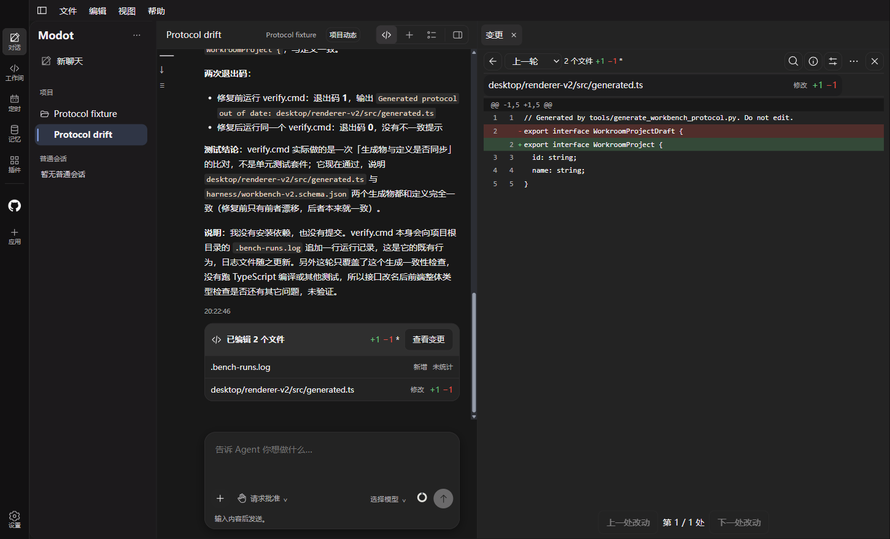

# Modot · Windows 编程 Agent

**面向本地项目的轻量级 AI 编程助手，会话直连代码工作间，记忆可查看、编辑和替换。**

[下载 Windows x64 预览版 .15](https://github.com/lq755467102-art/Modot/releases/download/v0.2.0-preview.15/Modot-Preview-0.2.0-preview.15-x64-Setup.exe) · [SHA256](https://github.com/lq755467102-art/Modot/releases/download/v0.2.0-preview.15/SHA256SUMS.txt) · [发行说明](https://github.com/lq755467102-art/Modot/releases/tag/v0.2.0-preview.15) · [English](README.en.md) · [源码可用许可](LICENSE.zh-CN.md)

在同一条会话里定位源码、审查改动、运行测试。工作间和会话共用项目、权限与操作记录。连接自己的模型，用 Skills 和 MCP 工具扩展能力，也可以为专项任务选择其他模型。

Windows x64 `.15` 安装包约 **142 MiB**。同机同工程的单次同题实测中，Modot Preview `.1` 执行任务的进程树私有工作集为 **249.1 MiB 中位数 / 275.2 MiB 采样峰值**。[三阶段内存对照与测量口径](#安装体积与桌面内存)

本仓库收录已验收的发布源码、发行说明和安装包。开发与测试构建在独立开发仓库进行。

[快速开始](#快速开始) · [工作间、任务核心与记忆](#工作间任务核心与记忆) · [扩展开发](#扩展开发) · [设计与实测](#设计与实测) · [许可](#许可)

## 工作间、任务核心与记忆

**在工作间里继续原会话。** Agent 修完测试后，从变更审查打开源码，代码工作间会跟随会话正在使用的目录或独立工作树。右栏保留同一条会话的历史、流式回复和审批，可以把当前文件或选区附回原会话。GitHub 工作间也用这套交互。打开 PR 后可以从侧栏询问失败检查，让 Agent 定位对应页面，或者回到实际检出查看本地文件。网页登录和 Agent 的 GitHub App 授权各有自己的入口。[工作间和会话](docs/modules.md#工作间和会话)

**用任务核心补足专项能力。** 主 Agent 默认可以独立完成任务。子 Agent 沿用主模型，代劳一项有明确范围的工作。任务核心使用你选择的专项模型，在自己的会话和授权内工作，父核心验收成果并负责交付。首个内置预设是视觉核心，可从「设置 → 模型」选择使用。[视觉核心上手](examples/worker-vision/) · [核心、工具和权限](docs/modules.md#任务核心与委派)

**记忆的内容和实现都由你选择。** 可以把排查线索留在当前会话，把测试约定保存为项目记忆，把经你采纳的做法记作跨项目习惯。默认记忆树可以编辑内容、调整权重，并按会话选择完整、精简或关闭带入。你也可以改用只在本会话保存的便签，或停用记忆实现。切换后各实现保留原数据，读取仍核对来源权限。[记忆配置与实现](docs/modules.md#记忆怎么自定义) · [会话便签示例](examples/memory-notes/)

## 快速开始

1. **在 Windows 上启动。** 下载上方的 .15 安装包，或用 CPython 3.13 和 Node.js 24 从源码启动。运行项目命令另需安装 Dokan 2 文件系统驱动。[安装与源码运行](docs/install.md)
2. **连接自己的模型。** 在「设置 → 模型」填写服务地址、模型名和 API key。模型调用走你配置的服务和账号。
3. **打开项目并发起任务。** 新建项目，选一个已有文件夹。把下面的测试命令换成你项目里可以复现问题的命令，再发给 Agent。

> 请先运行 `<测试命令>` 复现失败，定位第一个失败用例。做最小修复，再跑同一条命令。告诉我改了哪个文件、两次退出码和该用例的结果。

完成后，可以从会话进入**变更审查**看文件差异，展开**执行过程**看实际命令和输出。若选择本仓库体验，可先配置源码环境，再在开发终端运行 `python tools/generate_workbench_protocol.py --check`，核对工作间协议的生成文件。[协议检查脚本](tools/generate_workbench_protocol.py)



*桌面实测的一轮。会话报告 `verify.cmd` 从退出 1 变为退出 0，右侧同时审查生成文件的改动。* [题面和独立验收](docs/benchmarks/matched-desktop-memory.md)

## 在真实工程里的用法

- **用代码工作间处理日常编辑。** 用文件搜索找到入口，在同一界面比对改动、预览文件和运行检查。普通目录和 Git 工程都能开始，TS/JS、C/C++、Rust 和 Python 语言插件可按需启停。[项目与语言服务](docs/modules.md#各模块如何自定义)
- **接着上一次做。** 继续一段旧会话时，可以按权限查回之前的操作与原文。附件可以按需取图片、表格的工作表和行，以及 MP4、WebM 的指定时间段画面。复核旧结果时，先看对应运行和当前访问状态。[会话、附件与回读接口](docs/protocols.md)
- **把重复检查交给计划。** 一条计划绑定一条会话。到点执行、立即运行和补跑的结果都留在这里，各自有明确的历史轮次。[调度与运行记录](docs/modules.md)

项目、会话记录和工具回执保存在本机。每次请求会把当时需要的上下文发给你选择的模型服务。宿主负责工具授权，历史资料回读时重新检查当前权限。[数据流与授权](docs/modules.md)

## 扩展开发

项目与会话可选检出目录、运行配置和资料范围，模型与上下文可调提供方和带入方式，计划可选触发时间与运行配置。开发者可以用 Skill 写工作方法、用 MCP 接工具，也能以插件包贡献应用入口、记忆实现或委派能力。各入口沿用宿主的项目、会话、权限和回执机制。[各模块的设置与扩展入口](docs/modules.md#各模块如何自定义)

| 你想扩展什么 | 从可运行示例开始 |
| --- | --- |
| **Skill** · 让 Agent 按团队的约定梳理一项任务 | 改样例的 `SKILL.md`，填上适用条件、操作步骤和需要核对的材料。[大纲 Skill](examples/plugin-catalog/legacy-skill/skills/outline/SKILL.md) |
| **MCP 工具** · 读取你自己的数据或调用已有服务 | `mcp.json` 声明本地服务，标准 Python 实现 `read_note`。教程带你从参数校验跑到实际会话里的工具结果。[接入第一个工具](docs/develop-a-tool.md) |
| **插件页面** · 在桌面内增加一个操作入口 | 用数据页描述内容和动作。样例会把一条建议填进聊天草稿。[页面示例](examples/plugin-catalog/studio-v1/data-pages/overview.json) · [页面 Schema](docs/contracts/plugin-data-page-v1.schema.json) |
| **记忆实现** · 给会话选择不同的记忆方式 | 便签样包用 `memoryProvider` 声明预览版支持的 `session-notes` 数据适配器。安装后在「记忆实现」里选用。[记忆样包](examples/memory-notes/) · [接口](docs/protocols.md) |
| **委派** · 增加子 Agent 方法或专项任务核心 | 用 `plugin.json` 声明输入、成果和权限需求。任务核心另外声明模型角色。`modot.worker/1-draft` 为预览契约。[探路者](examples/worker-scout/) · [视觉核心](examples/worker-vision/) · [委派协议](docs/worker-plugin-contract.md) |

配置好源码环境后，可从仓库根目录检查扩展清单与生成的协议，并跑对应回归。

```powershell
& $env:HARNESS_PYTHON -B desktop/renderer-v2/tools/validate_plugin_manifest.py --json examples/plugin-catalog/studio-v1
& $env:HARNESS_PYTHON tools/generate_workbench_protocol.py --check
& $env:HARNESS_PYTHON -m unittest tools.test_worker_examples tools.test_public_preview
```

Electron 通过受限桥接访问本机 HTTP 服务，服务负责项目、会话和授权。协议文档列出接口、请求样例和对应测试。模块图可以定位上下文组装、执行策略和变更审查的源码入口。[接口与 Schema](docs/protocols.md) · [模块和数据流](docs/modules.md)

## 设计与实测

**一个更小的首包，仍可能跑更多轮。** 我们把 97 条旧工具回执移到按需回读后，首包输入少了 93.4%。一次复测却从 21 次模型请求增至 57 次，整轮费用也上升。逐包核对发现，重复带入的是本轮新回执。判断上下文优化是否有效，要一起看整题成本、用时和交付。[三次实测与请求排查方法](docs/engineering-efficiency.md)

**把模型误判、环境故障和框架遗漏拆开查。** 固定源码、工作目录、依赖和权限，先拿已知失败和已知修复校验评分器。命令启动失败时看执行环境，结果里缺少用例时查工具回执，模型拿到明确失败还报通过时把它记为一条误报。同一份回执也可以对照它实际进入了哪一个模型请求。[工程评分](docs/benchmarks/modot-engineering-scorecard.md) · [上下文与回执排查](docs/engineering-efficiency.md)

**“读到了图片”和“图片送到了模型”分别留证。** 两次读取同一张图时，按最终实际请求回填来源动作。文件读取期间发生撤权时，在回执返回前再检查一次。两处边界都可以用公开代码和回归用例验证。[发布审查](docs/release-review.md) · [专项测试](tools/test_public_preview.py)

### 安装体积与桌面内存

初版预览的完整安装约 **597 MiB**。`.15` 随安装包提供经验证的 LGPL 视频运行时，安装时按摘要校验 MinGit。[初版预览验收](docs/benchmarks/preview-validation.json) · [当前安装流程](docs/install.md)

同一台 Windows 11 上，三个桌面客户端在相同的 626 文件工程里修复同一处生成文件。独立检查确认三端均只改了预期文件，两次命令退出码都是 **1 → 0**。

| 桌面客户端 | 刚启动 | 打开工程 | 执行任务 |
| --- | ---: | ---: | ---: |
| Modot Preview `.1` | 143.1 / 146.2 | 166.9 / 170.3 | **249.1 / 275.2** |
| Codex | 558.2 / 1,628.4 | 1,105.4 / 1,110.0 | 1,340.0 / 1,481.2 |
| WorkBuddy | 1,184.6 / 1,189.5 | 822.3 / 825.8 | 1,405.8 / 1,518.3 |

表中是应用进程树私有工作集的**中位数 / 采样峰值**，单位 MiB。每端各测一次，模型、已加载的账号内容和审批模式有差别。报告提供三个阶段的起止条件与 320 个采样点。[完整实验与采样口径](docs/benchmarks/matched-desktop-memory.md) · [原始采样数据](docs/benchmarks/matched-desktop-memory.json)

历史工程题另有一组对照。Modot Pilot + DeepSeek Flash 与 Codex CLI + GPT-6.2 Sol 各通过 9/10 个评分项。双方均完成的九项，Modot 合计用时少 21.3%，用了约两倍 token。[逐题对照与条件](docs/benchmarks/modot-engineering-scorecard.md) · [成绩数据](docs/benchmarks/modot-2026-11-23-results.json)

## 源码与问题反馈

改界面从 `desktop/renderer-v2` 开始。查 Agent 决策、工具和回执从 `loop` 开始，测试入口主要在 `tools`。报告工程问题时，附上版本、模型、审批模式、复现命令和观测结果，方便把故障定位到对应环节。[源码启动、测试与打包](docs/install.md) · [模块入口](docs/modules.md)

## 平台路线

当前提供 Windows x64 预览版。Linux x64 和 macOS Apple Silicon 是后续支持目标，先验证原生启动、受管命令和任务续接，再准备各自的安装包。

## 许可

本候选采用 Modot 源码可用许可。个人和企业内部可以免费使用。免费变体可以公开源码或闭源，分发时需要保留许可和来源。收费转售、对外收费提供 Modot 功能或纳入收费产品须取得书面授权。历史版本已授予的 MIT 权利继续有效，第三方组件沿用各自的许可。[中文许可](LICENSE.zh-CN.md) · [英文许可](LICENSE) · [第三方组件和对应源码](desktop/THIRD_PARTY.md)
