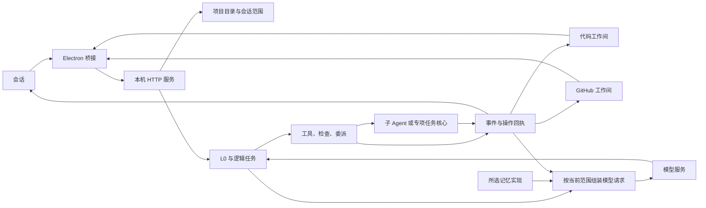

# 模块、设计取舍与源码入口

默认 L0 可以独立读文件、调用工具和交付结果。项目、会话和宿主授权为各模块提供共同边界。用户可以在预设上调整配置，开发者可以从模块公开的槽位和协议接入自己的能力。[产品术语](../GLOSSARY.md)

## 工作间和会话

项目组织会话和代码根。代码工作间跟随会话时，从同一个会话范围取它当前的项目目录或独立工作树，并复用原目录的文件服务。会话右栏挂载原会话的时间线、输入和审批组件。用户主动从编辑器带入文件或选区时，引用记录路径、行范围、保存版本与草稿状态。会话里的变更也能回到对应文件位置。[项目范围](../loop/projects.py) · [工作间绑定](../loop/project_workroom.py) · [右栏会话](../desktop/renderer-v2/src/WorkroomConversation.tsx) · [文件引用](../desktop/renderer-v2/src/WorkroomPage.tsx)

GitHub 工作间复用同一个会话右栏。仓库绑定取自会话实际可读的 Git 检出，网页地址可以独立切换。发送时捕获当前 PR 所属仓库和页签版本。Agent 可以核对当前 PR 的检查和提交，打开 Files changed 或定位某个检查。切页、切仓或撤销授权会使原请求失效。本地文件回到代码工作间，并核对当前检出的提交。网页账号按 Modot 档案保存，Agent 读取私库时同时核对仓库绑定和 GitHub App 权限。[GitHub 工作间](../desktop/renderer-v2/src/GitHubWorkroom.tsx) · [仓库与 PR 接口](../loop/github_workroom.py) · [网页登录隔离](../desktop/browser-view.cjs)

## 任务核心与委派

默认 L0 可以独立工作。子 Agent 复用父核心的主模型，任务核心使用用户选择的专项模型。宿主为每次委派核对身份、模型配置和可读资料，保留独立历史和结构化成果。视觉核心是首个内置预设，可以帮父核心读取或复核图像，父核心核对结果后负责交付。插件的「委派」入口涵盖子 Agent 和任务核心，声明同用预览契约 `modot.worker/1-draft`。[模型角色](../loop/task_core_models.py) · [公开契约](worker-plugin-contract.md) · [视觉核心上手](../examples/worker-vision/)

## 记忆怎么自定义

- **选内容与作用域。** 默认记忆树支持会话、项目和习惯三个范围。节点可编辑、调整权重或停用。项目记忆按项目和资料来源的授权读取，跨项目习惯由用户采纳。查看历史请求可以核对某条记忆是否实际带入。[记忆页](../desktop/renderer-v2/src/MemoryTreePage.tsx) · [选取与授权](../loop/memory_service.py)
- **选带入方式与实现。** 会话可选择完整、精简或关闭带入。也可在「记忆实现」中选用默认树、安装的会话便签或停用全部记忆。切换保留各实现原数据，新启用的实现从下一轮生效，撤销立即生效。[记忆实现管理](../desktop/renderer-v2/src/MemoryProviderControl.tsx) · [便签样包](../examples/memory-notes/)
- **从适配器接入。** 预览版的包清单通过 `memoryProvider` 选择数据型 `session-notes`。宿主代码可以通过 `register_adapter` 注册受信任实现。读写能力由适配器声明，宿主校验会话授权并把所选实现绑定到本轮请求。[适配器注册](../loop/memory_providers.py) · [模型请求中的记忆](../loop/memory_runtime.py)

## 各模块如何自定义

| 模块 | 可调整的设置或扩展入口 | 契约与实现 |
| --- | --- | --- |
| 会话、任务与恢复 | 按会话选项目和资料、设置下一轮运行限制，按原任务续接。逻辑任务、运行和工具操作各自留存身份。 | [原生入口](../loop/native_entry.py) · [会话](../loop/session.py) · [检查会话](../loop/check_sessions.py) |
| 模型与上下文 | 配置服务地址、模型和上下文窗口，选择允许带入的资料。可用请求归档对照模型实际收到的内容。 | [模型配置](../loop/models.py) · [提供方适配](../loop/provider.py) · [上下文投影](../loop/context_view.py) |
| 工具、审批与证据 | 选择授权范围和执行模式，按需启用 Skill 和 MCP 工具。宿主校验操作与返回的证据。 | [工具注册](../loop/tools.py) · [执行策略](../loop/execution_policy.py) · [证据](../loop/evidence.py) |
| 工作间、Git 与项目 | 项目可用普通文件夹、Git 检出或工作树，可登记多个代码根。编辑器可启停语言服务，按槽位接入格式化与测试。 | [项目](../loop/projects.py) · [工作间](../loop/project_workroom.py) · [语言服务](../loop/workroom_language.py) · [格式化](../loop/app_formatting.py) · [测试](../loop/app_testing.py) |
| 运行器与计划 | 选择环境预设、计划时间、权限与轮次限制。一条计划绑定一条会话，每次执行保留各自的结果。 | [运行配置](../loop/workbench.py) · [计划配置](../loop/scheduled_tasks.py) · [运行调度](../loop/scheduled_execution.py) |
| 文件、附件与媒体 | 选择资料授权和实际入包的范围，例如工作表行段或指定时间的画面。源码中的读取器保留各格式的返回类型和回执。 | [附件入口](../loop/attachments.py) · [表格与文档](../loop/documents.py) · [视频抽帧](../loop/video_frames.py) · [图像回执](../loop/image_evidence.py) |
| 记忆与 Skill | 调整记忆范围、条目权重和带入模式，选择记忆实现。用 Skill 描述团队自己的工作方法。 | [记忆适配](../loop/memory_providers.py) · [技能发现](../loop/skills.py) · [便签样例](../examples/memory-notes/plugin.json) |
| 插件与 MCP | 插件包可以贡献数据页、Skill、MCP 服务等能力，用户按包或能力管理启用状态。 | [包发现与安装](../loop/plugin_packages.py) · [MCP](../loop/plugin_mcp.py) · [页面 Schema](contracts/plugin-data-page-v1.schema.json) |
| 委派与任务核心 | 声明输入、能力和成果，按任务选择方法和授权。为任务核心选择专项模型，由父会话回收与核对成果。 | [委派实现](../loop/subtasks.py) · [委派契约](../loop/worker_contract.py) · [探路者样例](../examples/worker-scout/plugin.json) |

从一个能运行的最小例子开始扩展 Modot。写工作方法可先改 `outline` 的 Markdown，开发工具可从便签 MCP 入手，编写子 Agent 再尝试只读探路者。[Skill 源码](../examples/plugin-catalog/legacy-skill/skills/outline/SKILL.md) · [MCP 服务与清单](../examples/plugin-catalog/studio-v1/) · [接口协议](protocols.md)
